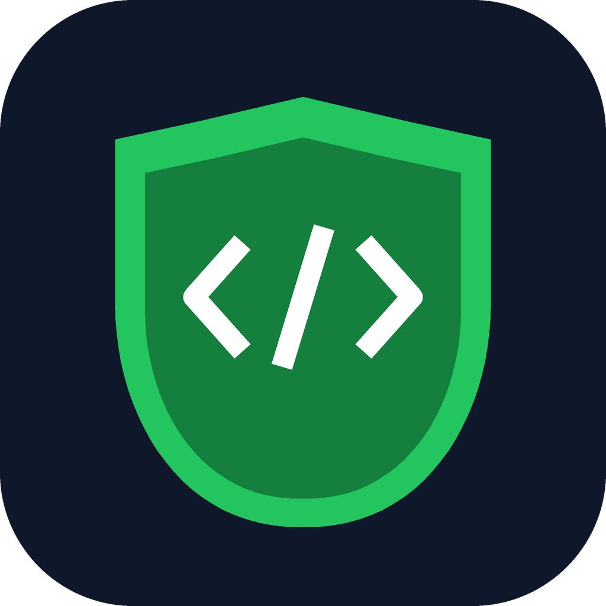

<p align="center"></p>

<h1 align="center">Secure Vibe Coding</h1>

<p align="center">
  <a href="https://www.skills.sh/nandhu-44/secure-vibe-coding"></a>
  <a href="#claude-code-plugin-skills--hooks"></a>
  <a href="https://github.com/nandhu-44/secure-vibe-coding/actions/workflows/ci.yml"></a>
  <a href="LICENSE"></a>
  <a href="skills/secure-web/references/owasp-top10-2025.md"></a>
  <a href="https://github.com/nandhu-44/secure-vibe-coding/stargazers"></a>
</p>

**Secure-by-default skills for AI coding agents**, built so that older and open-weight models (Ollama, LM Studio, vLLM) can produce safe code too, not just frontier models.

Secure Vibe Coding is a pack of [Agent Skills](https://code.claude.com/docs/en/skills) plus a dependency-free scanner and an auto-scan hook. It targets the flaws vibe-coded projects ship with: hardcoded secrets, `http://` endpoints, disabled TLS checks, missing authorization (IDOR), no rate limiting, string-built SQL, weak crypto, business-logic holes, unsafe C, hallucinated packages, open CI pipelines, and LLM features that execute model output.

> Why not just tell the model "write secure code"? Because it measurably doesn't work. In SecureAgentBench ([Chen et al., 2025](https://arxiv.org/abs/2509.22097)), a generic security reminder produced **zero** improvement and increased failed runs. Secure Vibe Coding uses concrete rules, copyable secure patterns, and automated scanner feedback instead. See [docs/RESEARCH.md](docs/RESEARCH.md).

## Quick install

| Agent | Command |
|---|---|
| **Any agent (skills.sh)**: Claude Code, Codex, Cursor, OpenCode, Gemini CLI, … | `npx skills add nandhu-44/secure-vibe-coding` |
| **Claude Code plugin** (skills + hooks, recommended) | `claude plugin marketplace add nandhu-44/secure-vibe-coding`<br>`claude plugin install secure-vibe-coding@secure-vibe-coding` |
| **Claude Code, from inside a session** | `/plugin marketplace add nandhu-44/secure-vibe-coding`<br>`/plugin install secure-vibe-coding@secure-vibe-coding` |
| **Small local models** (Aider + Ollama) | `aider --read secure-vibe-coding/dist/AGENTS.compact.md` |

Details and other agents are in [Install](#install).

## What's inside

| Skill | Use when | Highlights |
|---|---|---|
| [`secure-coding`](skills/secure-coding/SKILL.md) (core) | Any code change | 3-step workflow (threat-model-lite → core card → scan + one-pass self-review); **Never/Always core card**; secrets, crypto, logging references |
| [`secure-web`](skills/secure-web/SKILL.md) | Routes, APIs, auth, uploads, payments | IDOR/BOLA, sessions/JWT/OAuth, injection, CSRF/CORS/CSP, **rate-limiting per framework**, **business-logic flaws**, SSRF; Express, Next.js, FastAPI, Django, Flask, Spring, Go, Laravel, Supabase/Firebase guides |
| [`secure-lowlevel`](skills/secure-lowlevel/SKILL.md) | C/C++, Rust `unsafe`, cgo, embedded | Bounds and parser patterns, integer overflow, ownership/double free/UAF, CWE-14 secret wiping, hardening flags, sanitizers and fuzzing |
| [`secure-supply-chain-infra`](skills/secure-supply-chain-infra/SKILL.md) | Dependencies, Docker, CI, Terraform, K8s | Slopsquatting defense, pinning and lockfiles, GitHub Actions injection, OIDC, non-root containers, IaC defaults |
| [`secure-ai-features`](skills/secure-ai-features/SKILL.md) | Apps calling LLMs, agents, RAG, MCP | Assume prompt injection; tool authz from session; output handling; RAG ACLs; cost limits; MCP server and client rules |
| [`secure-review`](skills/secure-review/SKILL.md) | "Review/audit this for security" | Scanner + external tools → attack-surface map → prioritized, evidenced findings |

**Tooling**
- `skills/secure-coding/scripts/secscan.py`: stdlib-only scanner. 60+ rules across secrets, transport, injection, crypto, web config, memory safety, containers, CI, IaC, and LLM, with a Python AST pass. Output includes CWE/OWASP tags and fixes. Use `--with-external` to merge semgrep, gitleaks, and bandit results.
- `hooks/hooks.json`: two Claude Code hooks. **SessionStart** injects the core card into every session, because models (especially smaller ones) often don't invoke skills on their own. **PostToolUse** scans every file the agent writes: HIGH findings block and are fed back to the agent, and MEDIUM findings (for example "login route with no rate limiting") become hints. Opt out with `SECUREVIBE_SESSION_CONTEXT=off` / `SECUREVIBE_HOOK=off`.
- `tools/build_dist.py`: generates rule files for Cursor, Windsurf, Continue, Cline, Copilot, and `AGENTS.md` agents, plus a **compact ~1.5k-token core card** for small-context local models.
- `evals/`: 20 realistic prompts that tempt agents into insecure code, with a runner that compares baseline vs pack for any agent CLI.

## Install

### Any skills-compatible agent via [skills.sh](https://www.skills.sh/nandhu-44/secure-vibe-coding)
List the six skills:
```bash
npx skills add nandhu-44/secure-vibe-coding --list
```
Install them (an interactive prompt lets you pick agents and skills):
```bash
npx skills add nandhu-44/secure-vibe-coding
```
Install **all six** skills together, because the domain skills call the scanner that ships inside `secure-coding`. The hooks (always-on rules and the post-edit scan) only come with the Claude Code plugin below.

### Claude Code plugin (skills + hooks)
The plugin adds all six skills, the SessionStart hook that keeps the core rules always on, and the post-edit scanner hook. Add this repo as a marketplace, then install:
```bash
claude plugin marketplace add nandhu-44/secure-vibe-coding
```
```bash
claude plugin install secure-vibe-coding@secure-vibe-coding
```
Inside a Claude Code session, the same thing is `/plugin marketplace add nandhu-44/secure-vibe-coding`, then `/plugin install secure-vibe-coding@secure-vibe-coding`. Get updates with `claude plugin update secure-vibe-coding@secure-vibe-coding`.

To try it for one session without installing, clone the repo and load it directly:
```bash
git clone https://github.com/nandhu-44/secure-vibe-coding
```
```bash
claude --plugin-dir ./secure-vibe-coding
```
Skills only, without the hooks: copy `skills/*` into `~/.claude/skills/` (all projects) or `.claude/skills/` (one project).

### Codex CLI, OpenCode, Jules, Zed, Amp and other `AGENTS.md` readers
Vendor the repo at `./secure-vibe-coding` (a git submodule or a copy) so reference links and the scanner resolve. Then:
```bash
git submodule add https://github.com/nandhu-44/secure-vibe-coding secure-vibe-coding
cp secure-vibe-coding/dist/AGENTS.md AGENTS.md            # full pack (~12k tokens)
cp secure-vibe-coding/dist/AGENTS.compact.md AGENTS.md    # small/local models (~1.5k tokens)
```

### Aider + Ollama (local models)
```bash
aider --model ollama_chat/qwen2.5-coder:14b --read secure-vibe-coding/dist/AGENTS.compact.md
```
Raise Ollama's context (`OLLAMA_CONTEXT_LENGTH=16384` or `num_ctx`) so the rules aren't truncated. The default 2–4k context silently drops system text.

### Cursor / Windsurf / Continue / Cline / Copilot
Copy the matching folder from `dist/` into your project root:
`dist/.cursor/rules/`, `dist/.windsurf/rules/`, `dist/.continue/rules/`, `dist/.clinerules/`, `dist/.github/copilot-instructions.md` and `dist/.github/instructions/`.
The core rule is always on. Domain rules activate by file glob (C/C++, Docker/CI/IaC) or by the agent's own decision (web, AI).

### Scanner on its own (pre-commit / CI)
```bash
python3 secure-vibe-coding/skills/secure-coding/scripts/secscan.py .              # whole repo
python3 secure-vibe-coding/skills/secure-coding/scripts/secscan.py --changed      # git changes only
python3 secure-vibe-coding/skills/secure-coding/scripts/secscan.py src --json --fail-on medium
```
Exit code is 1 when findings reach `--fail-on` (default `high`). Suppress a verified false positive with `secure-vibe-coding: ignore[SV-NET-001] reason` on the same line or the line above.

## Choosing a tier for your model
| Model / context | Use |
|---|---|
| Frontier models (Claude, GPT-5, Gemini 2.5+) with skills support | Plugin or skills + hook |
| 14B–70B local models, ≥16k context | `AGENTS.md` (full) or core + one domain rule, plus the scanner in your loop |
| ≤8B models or ≤8k context | `AGENTS.compact.md` + run `secscan.py` after each task and paste findings back |

Hooks and scanner feedback help weak models the most. If your agent supports post-edit hooks (Claude Code, Cline, Cursor), wire up `hook_post_edit.py`. Otherwise, run the scanner in your loop.

## Measuring it
```bash
# Claude Code baseline vs plugin
python3 evals/run_eval.py --agent 'claude -p {prompt} --permission-mode acceptEdits' \
  --agent-with 'claude -p {prompt} --permission-mode acceptEdits --plugin-dir {pack_root}' --modes none,plugin
# Aider + Ollama, baseline vs compact rules
python3 evals/run_eval.py --agent 'aider --model ollama_chat/qwen2.5-coder:7b --yes-always --no-git --message {prompt}' \
  --modes none,compact --compact-read --repeat 3
```
See [evals/README.md](evals/README.md) for categories (SEC / INS / CE / NO) and how to add scenarios.

## Development
```bash
python3 -m pytest tests -q      # scanner fixtures, hook, lint, dist freshness, eval runner
python3 tools/build_dist.py     # regenerate dist/ after editing skills
```
See [CONTRIBUTING.md](CONTRIBUTING.md).

## Limitations
- This is **defense in depth, not a guarantee**. Rules files and skills steer models, they don't make them correct. The regex/AST scanner catches common patterns and will miss logic flaws and novel bugs. Keep human review, tests, and real SAST/DAST in the loop for anything that matters.
- Scanner rules are tuned for low noise in app code. Library or framework code produces more hits (`eval`/`pickle` in tooling, for example).

## Related work
[Project CodeGuard](https://github.com/cosai-oasis/project-codeguard) (CoSAI) · [OpenSSF AI code assistant guide](https://best.openssf.org/Security-Focused-Guide-for-AI-Code-Assistant-Instructions) · [Trail of Bits skills](https://github.com/trailofbits/skills) (audits) · [Wiz rules files](https://www.wiz.io/blog/safer-vibe-coding-rules-files). A comparison is in [docs/RESEARCH.md](docs/RESEARCH.md).

License: Apache-2.0. See [NOTICE](NOTICE) for attributions and [docs/RESEARCH.md](docs/RESEARCH.md#references) for the full list of sources.
